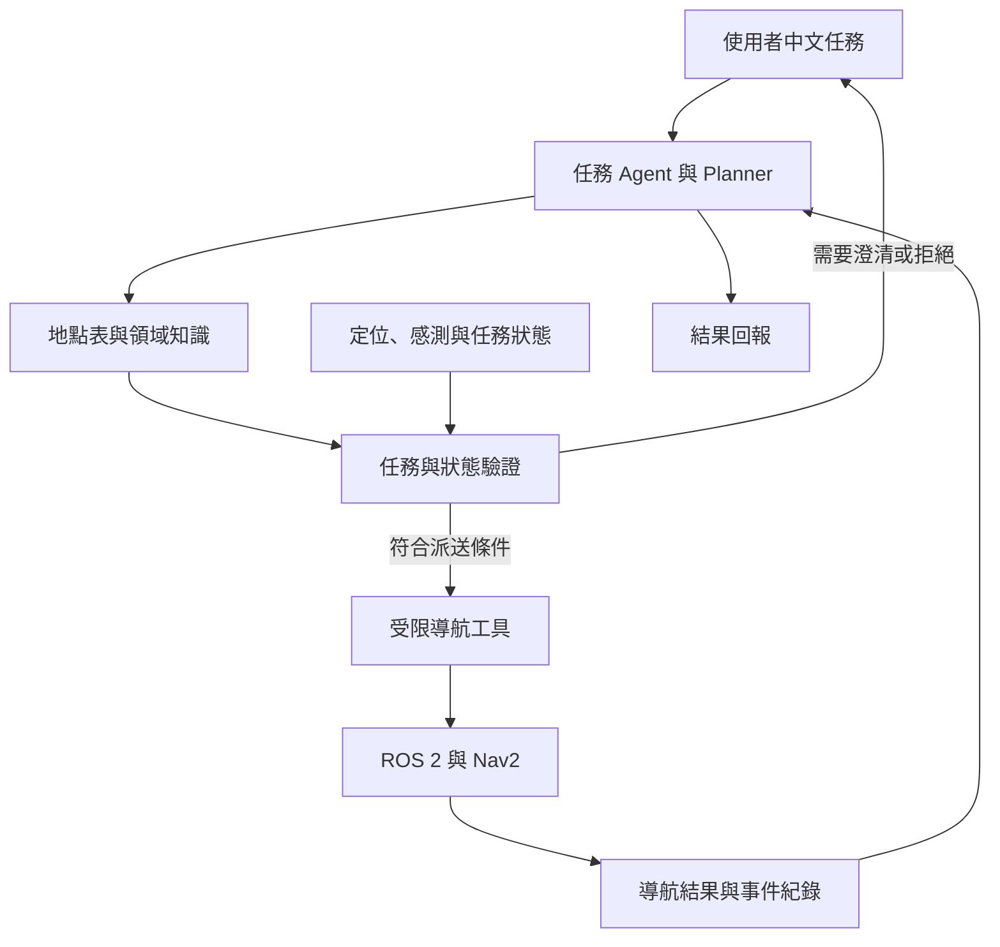

# TurtleBot3 Burger 室內導航與任務決策 AI Agent

**Indoor Navigation and Task Decision Agent for TurtleBot3 Burger**  
期中分組專題提案 · 第 7 組

本專題探討如何讓使用者以中文指定室內目的地，並由 AI Agent 完成任務理解、地點查詢、狀態檢查與結果回報。預計以 TurtleBot3 Burger 為平台，結合大型語言模型（LLM）與 ROS 2／Nav2，建立能處理歧義與導航失敗的任務介面。

> **開發階段：Proposal 與離線原型。** 本儲存庫已提供提案文件及結構化任務驗證範例。程式使用 mock 狀態與導航結果，尚未整合 LLM、ROS 2／Nav2 或實體小車。下方的完整系統架構與導航實驗均為預計設計。

[提案報告 PDF](docs/TB3_Proposal.pdf) · [提案簡報 PPTX](docs/TB3_Proposal.pptx) · [系統設計 DESIGN.md](DESIGN.md) · [實驗規畫](docs/EXPERIMENTS.md) · [參考資料](docs/REFERENCES.md)

## 目錄

- [一、專題背景與目標](#一專題背景與目標)
- [二、系統架構](#二系統架構)
- [三、目前實作狀態](#三目前實作狀態)
- [四、快速開始](#四快速開始)
- [五、Docker 執行方式](#五docker-執行方式)
- [六、實驗設計與評估](#六實驗設計與評估)
- [七、專案檔案導覽](#七專案檔案導覽)
- [八、整合規畫與限制](#八整合規畫與限制)
- [九、組員與分工](#九組員與分工)
- [十、資料來源、AI 使用與授權](#十資料來源ai-使用與授權)

## 一、專題背景與目標

室內移動機器人除了需要規劃路徑與避開障礙物，也需要正確理解使用者的任務。「去門口」可能對應多個地點，感測資料可能過期，導航也可能因路徑受阻而失敗。若只將文字轉成目標，仍不足以處理這些情境。

本專題以已登錄的室內地點為範圍，預計建立以下能力：

| 設計目標 | 預計處理方式 | 評估重點 |
|---|---|---|
| 將中文任務轉為可檢查的請求 | LLM 輸出符合 schema 的結構化任務 | 任務處理正確率 |
| 避免歧義或不存在的地點造成派送 | 地點白名單驗證，必要時詢問使用者 | 不當派送率 |
| 在執行前確認小車是否可用 | 檢查定位、感測資料時效與任務狀態 | 異常案例處理 |
| 讓回報具有執行依據 | 依導航 action 與事件紀錄回報結果 | 回報正確率與延遲 |

**預計互動情境：** 使用者說「去門口」，Agent 發現有兩個已登錄的門口後先詢問；使用者選定地點，系統再檢查小車狀態並派送導航。任務結束後，依執行結果回報到達、失敗、取消或逾時。此情境描述完整系統的預期行為，現有離線程式只接受事先準備的 JSON。

## 二、系統架構

以下為**預計整合架構**。LLM 負責任務理解與互動，ROS 2／Nav2 負責導航規劃與控制。



目的地座標由已登錄的地點表取得，LLM 不直接產生輪速、任意座標或修改控制參數。導航結束必須依 action 結果判斷；取消請求被接受，也不等於已確認實體小車停止。

完整模組、流程、狀態與工具介面見 [DESIGN.md](DESIGN.md) 與 [INTERFACES.md](docs/INTERFACES.md)。

## 三、目前實作狀態

| 項目 | 狀態 | 本版本內容 |
|---|---|---|
| 期中提案與簡報 | 已提供 | 文獻整理、Deep Research、架構與實驗規畫 |
| 系統設計文件 | 已提供 | 模組責任、工具介面與狀態處理 |
| 結構化任務格式驗證 | 已實作，限離線 | 檢查 intent、欄位與地點白名單 |
| 狀態與結果處理範例 | 已實作，限 mock | 示範忙碌、過期資料、無路徑、失敗與逾時 |
| 單元測試 | 已提供 | 任務格式、派送條件與回報行為測試 |
| Dockerfile | 已提供，待建置驗證 | 包裝離線 Python 範例 |
| 中文自然語言解析 | 待實作 | 尚未連接 LLM |
| ROS 2／Nav2 adapter | 待實作 | 尚未連接導航 action 與即時狀態 |
| 模擬與實機比較實驗 | 待執行 | 目前僅有規畫與結果欄位範本 |

小車平台的獨立操作進度，與本儲存庫 Agent 程式的整合完成度分別記錄。現有範例的輸出不能作為實體導航成功率。

## 四、快速開始

### 4.1 執行環境

離線範例使用 **Python 3.10 以上版本**，只使用標準函式庫，不需要 API Key、ROS 2 或第三方 Python 套件。

```bash
git clone https://github.com/hank050392/tb3-navigation-agent.git
cd tb3-navigation-agent
python3 src/agent_demo.py --request examples/navigate.json --scenario ready
```

Windows 若使用 `python` 啟動 Python，請將下列指令中的 `python3` 改為 `python`。所有指令都從專案根目錄執行。

### 4.2 輸入與輸出

導覽請求範例位於 [`examples/navigate.json`](examples/navigate.json)：

```json
{
  "intent": "navigate",
  "landmark_id": "desk"
}
```

`landmark_id` 必須存在於 [`config/landmarks.json`](config/landmarks.json)。其中座標為離線示範資料，整合實機前必須重新登錄與核對。

輸出為 JSON，包含 `demo_only`、`navigation_backend`、`status`、`goal_sent`、`timestamp` 與 `evidence` 等欄位。`navigation_backend: "mock"` 表示程式使用模擬結果；此處的 `goal_sent` 只表示離線流程進入派送分支。

### 4.3 情境示範

| 示範情境 | 執行指令 | 預期狀態 |
|---|---|---|
| 一般任務 | `python3 src/agent_demo.py --request examples/navigate.json --scenario ready` | `ARRIVED`，僅代表 mock 成功 |
| 澄清請求 | `python3 src/agent_demo.py --request examples/ambiguous.json --scenario ready` | `CLARIFY` |
| 資料過期 | `python3 src/agent_demo.py --request examples/navigate.json --scenario stale` | `NOT_READY` |
| 路徑受阻 | `python3 src/agent_demo.py --request examples/navigate.json --scenario blocked` | `NO_PATH` |
| 導航失敗 | `python3 src/agent_demo.py --request examples/navigate.json --scenario failed` | `FAILED` |
| 導航逾時 | `python3 src/agent_demo.py --request examples/navigate.json --scenario timeout` | `TIMEOUT` |
| 已有任務 | `python3 src/agent_demo.py --request examples/navigate.json --scenario busy` | `BUSY` |
| 取消請求 | `python3 src/agent_demo.py --request examples/cancel.json --scenario busy` | `CANCELED`，`stop_confirmed` 為 `false` |

澄清文字由輸入 JSON 提供，現有程式不會自行辨識中文歧義。取消情境也只示範回傳格式，沒有控制實體馬達。

### 4.4 測試

```bash
python3 -m unittest discover -s tests -v
```

測試涵蓋地點白名單、額外座標欄位拒絕、格式與型別、異常狀態不派送、澄清、失敗與逾時，以及取消回報。這些測試驗證離線程式的邏輯，尚未驗證 LLM 語言理解或導航品質。

## 五、Docker 執行方式

儲存庫提供以 `python:3.12-slim` 為基礎的 Dockerfile：

```bash
docker build -t tb3-agent-proposal .
docker run --rm tb3-agent-proposal
docker run --rm tb3-agent-proposal python -m unittest discover -s tests -v
```

預設執行一般任務的 mock 情境。此映像設定僅包裝離線範例，尚未建置驗證，也未包含 ROS 2、Gazebo 或實機裝置設定。

## 六、實驗設計與評估

### 6.1 比較方法

預計固定相同地圖、車身設定與 Nav2 參數，比較三種任務介面：

| 方法 | 設計 | 比較用途 |
|---|---|---|
| B0 固定地點選單 | 使用者選取已登錄地點 | 建立共同導航底層的介面基準 |
| B1 直接語言轉目標 | LLM 解析地點，檢查 schema 與白名單 | 評估基本語言介面 |
| B2 完整 Agent | 加入澄清、狀態檢查與證據回報 | 評估額外任務管理機制 |

B0 沒有自然語言輸入，所以語言處理正確率只比較 B1 與 B2。各組保留相同底層停止機制。

### 6.2 預計資料與指標

預計建立 60 筆中文指令，依語意模板分組切分為 20 筆開發資料與 40 筆測試資料，涵蓋明確地點、歧義、未知地點、取消、複合任務與越權／矛盾輸入。`examples/` 中的 JSON 為工程示範，並非這份實驗資料集。

模擬場景預計包含空曠、窄通道、新增障礙物與狀態異常／不可達情境。評估將區分語言處理、完整任務完成、純導航成功、回報一致性與延遲，並規畫澄清及前置狀態檢查的消融實驗。

**目前尚無比較實驗結果。** 樣本數、配對設計、指標定義與統計方式詳見 [EXPERIMENTS.md](docs/EXPERIMENTS.md)；[`data/results_template.csv`](data/results_template.csv) 僅提供紀錄欄位。

## 七、專案檔案導覽

| 路徑 | 內容 |
|---|---|
| [`README.md`](README.md) | 專題入口、進度與執行說明 |
| [`DESIGN.md`](DESIGN.md) | 架構、模組責任、流程與演算法 |
| [`PROPOSAL.md`](PROPOSAL.md) | 提案 Markdown 內容 |
| [`docs/TB3_Proposal.pdf`](docs/TB3_Proposal.pdf) | 提案報告 PDF |
| [`docs/TB3_Proposal.pptx`](docs/TB3_Proposal.pptx) | 提案簡報 |
| [`docs/INTERFACES.md`](docs/INTERFACES.md) | 工具與導航介面規格 |
| [`docs/EXPERIMENTS.md`](docs/EXPERIMENTS.md) | 比較實驗與評估方法 |
| [`docs/TEAM.md`](docs/TEAM.md) | 組員資料與預計工作角色 |
| [`docs/REFERENCES.md`](docs/REFERENCES.md) | 參考資料 |
| [`docs/SUBMISSION_CHECKLIST.md`](docs/SUBMISSION_CHECKLIST.md) | 繳交檢查表 |
| [`assets/`](assets/) | 架構與流程圖片 |
| [`config/`](config/) | 示範地點資料 |
| [`examples/`](examples/) | 結構化任務 JSON 範例 |
| [`src/`](src/) | 離線任務驗證程式 |
| [`tests/`](tests/) | 單元測試 |
| [`data/`](data/) | 實驗結果紀錄範本 |
| [`Dockerfile`](Dockerfile) | 離線範例容器設定 |

## 八、整合規畫與限制

後續預計先核對小車端與電腦端的 ROS 2／Nav2 版本、地圖與通訊介面，建立導航基準，再加入 LLM 結構化輸出與導航 adapter。完成介面整合後，才進行鎖定測試、消融與實機示範。

第一版聚焦單台 TurtleBot3 Burger、單一室內平面、預建地圖與人工命名地點。任意物體辨識、取放、多車協調及端對端強化學習不在第一版範圍。動態障礙物與長期運作則列為後續延伸。

ROS 2 與 Gazebo 的具體組合仍需與實機環境核對，對應啟動指令將於整合驗證後補上。LLM 服務與澄清可能增加互動延遲，地點查詢與雷射感測也各有適用範圍，後續評估會一併揭露。

## 九、組員與分工

**第 7 組**

| 中文姓名 | 學號 |
|---|---|
| 陳至恆 | 7115064009 |
| 蕭丞皓 | 7115064186 |
| 林瑞裕 | 7115064168 |
| 邱原美 | 7115064159 |
| 官奕愷 | 7115093001 |

預計工作涵蓋領域研究、AI 文獻與 LLM、Agent 與工具介面、ROS 2／Nav2 整合及實驗評估。個人工作角色待全組確認，詳見 [TEAM.md](docs/TEAM.md)。

## 十、資料來源、AI 使用與授權

文獻與平台文件整理於 [REFERENCES.md](docs/REFERENCES.md)。AI 協助提案撰寫與程式骨架製作，組員負責核對資料來源、理解設計與完成後續實作驗證。

本儲存庫尚未指定對外發布授權；第三方資料與軟體仍依其原有授權使用。專題未以預期數值冒充實驗結果。
